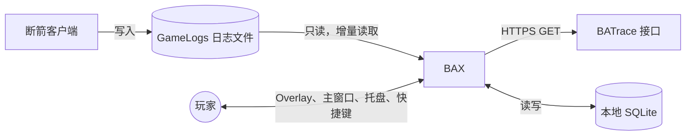
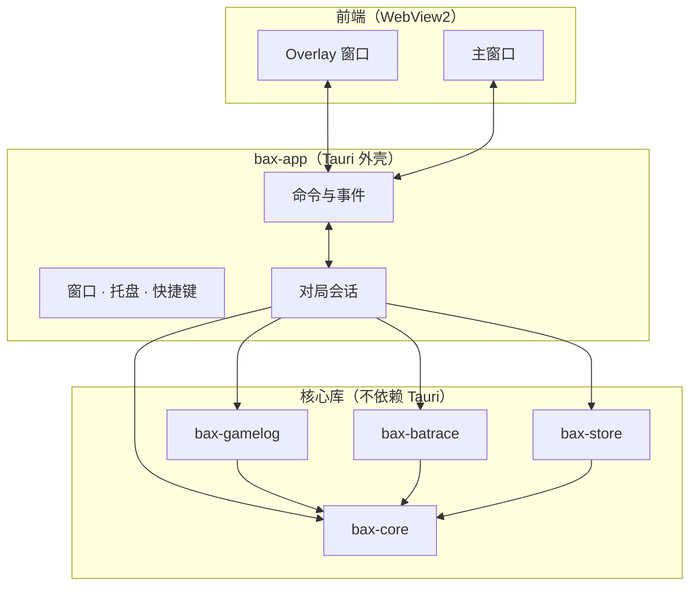
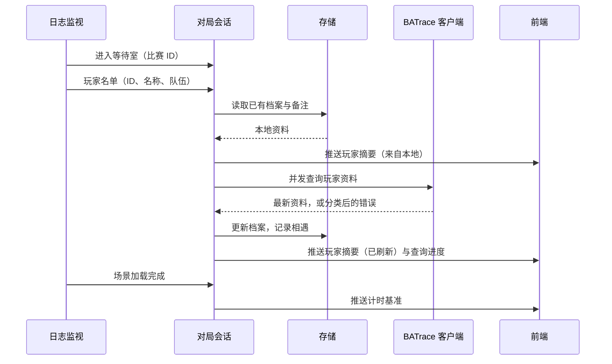
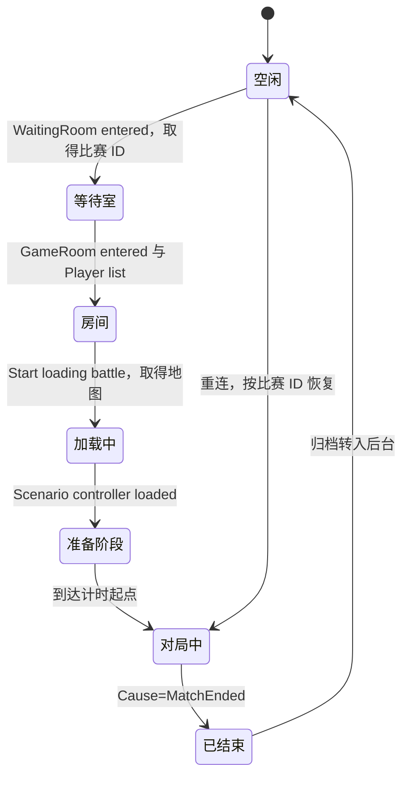

# BAX 总体架构

状态：草案 · 更新：2026-11-16 · 依据：[项目规划](../planning/project-plan.md)

本文说明 BAX 由哪些部分组成、各部分的职责边界、数据如何流动，以及代码仓库如何组织。需求、数据来源的实测结果和推进顺序以项目规划为准，这里只写结构。规划中标为待定的内容（前端框架、表结构等），本文给出边界和约束，具体取值留到对应的可行性验证之后。

## 设计约束

| 约束 | 来源 | 对结构的影响 |
|---|---|---|
| 游戏运行期间常驻 | Overlay 与计时提醒 | 后台任务保持轻量；较重的窗口和图表按需创建 |
| 数据只来自游戏日志文件和 BATrace | 规划的数据链路 | 只读文件与 HTTPS 请求，不读取游戏内存，不向游戏进程注入 |
| 外部来源不稳定 | 日志有重复事件、空名字、重连；接口出现过 403，部分字段为空 | 解析与请求都要能表达“未知”和“缺失”，并且可以降级 |
| 备注与历史长期保留 | 玩家档案、相遇记录、战报归档 | 长期数据与可过期缓存分开存放 |
| 核心逻辑可回放测试 | 规划要求用真实日志回放覆盖重连、文件切换等情况 | 解析、状态机、统计不依赖窗口、网络和系统时钟 |
| 首阶段不做作弊与异常行为判定 | 已确定事项 | 原型的检测规则与扫描流程不移植，见 [ADR-0002](../adr/0002-exclude-cheat-detection.md) |

## 系统上下文



BAX 与游戏之间只有两个接触面：读取游戏写出的日志文件，以及把一个置顶窗口叠在游戏画面上。

## 分层与模块



| 模块 | 职责 | 不做的事 |
|---|---|---|
| `bax-core` | 领域类型（玩家、比赛、队伍、单位实例）；对局生命周期状态机；计时基准与提醒到期计算；统计口径 | 不做任何 IO，不读系统时钟，当前时间由调用方传入 |
| `bax-gamelog` | 发现 Steam 库与日志目录；增量读取（半行、UTF-8 边界、截断、新文件切换）；把日志行解析为事件 | 不维护对局状态，不解释事件的业务含义 |
| `bax-batrace` | 统一 HTTP 客户端；响应模型与缺失字段处理；错误分类；退避重试 | 不写数据库，不决定何时刷新 |
| `bax-store` | SQLite 连接、迁移和读写；长期库与缓存库 | 不发起网络请求 |
| `bax-app` | Tauri 外壳；把四个库组装成后台任务；前后端通信；窗口、托盘、快捷键；必要的 Win32 补充 | 不实现解析规则和统计规则 |
| 前端 | Overlay 与主窗口的展示、交互和主题 | 不保存业务状态的权威副本，不直接访问网络或文件 |

依赖方向是单向的：`bax-core` 不依赖其他成员；`bax-gamelog`、`bax-batrace`、`bax-store` 只依赖 `bax-core`，彼此之间不依赖；只有 `bax-app` 依赖全部。原型里 `Overlay` 一个类同时调度界面、查询和检测，这里用编译单元把这三件事隔开。拆分理由与备选方案见 [ADR-0003](../adr/0003-workspace-layout.md)。

## 仓库结构

```text
BAX/
├── Cargo.toml              Cargo workspace 清单
├── crates/
│   ├── bax-core/           领域模型、生命周期、计时、统计
│   ├── bax-gamelog/        日志发现、读取、解析
│   ├── bax-batrace/        BATrace 客户端
│   └── bax-store/          SQLite 存储
├── src-tauri/              bax-app：Tauri 外壳与后台任务编排
├── src/                    前端源码（框架待定）
│   ├── overlay/            Overlay 窗口入口
│   ├── main/               主窗口入口
│   └── shared/             通信封装、状态订阅、主题变量
├── tools/                  验证与开发用的小工具（日志回放、接口探测）
├── fixtures/               脱敏后的日志与战报样本，按原始字节保存
├── docs/                   文档，见 docs/README.md
└── .local/                 本机原始数据，不入库
```

目前只有 `docs/` 存在，其余目录在进入对应工作时创建。`src-tauri/` 与 `src/` 放在仓库根目录，与 Tauri 命令行工具的默认约定一致。`tools/` 里的验证程序直接依赖 `crates/` 下的库，可行性验证写出的解析和请求代码因此能留在正式代码里。

## 运行时结构

应用是一个 Tauri 进程加上 WebView2 子进程。Rust 一侧运行以下后台任务：

| 任务 | 输入 | 输出 |
|---|---|---|
| 日志监视 | 日志文件的追加、截断与切换 | 日志事件 |
| 对局会话 | 日志事件、接口结果、计时到期、用户命令 | 状态快照与推送事件 |
| 玩家资料获取 | 会话给出的玩家 ID 列表 | 玩家摘要：先返回本地已有资料，再返回刷新结果 |
| 战后归档 | 比赛结束 | 战报入库，相关玩家档案更新 |
| 提醒调度 | 计时基准与提醒配置 | 提醒事件 |

对局会话是唯一写入当前对局状态的任务。所有输入以消息形式排队进入，由它按顺序处理，状态因此不需要跨任务加锁。每个对外请求都带上发起时的比赛 ID；结果返回时如果比赛已经切换，直接丢弃。这对应原型 `EloService` 里的过期请求隔离。

### 对局中的数据流



### 战后的数据流

比赛结束事件触发战后归档。战报在比赛结束后不一定立即可用，归档任务按退避间隔重试，并区分空结果、部分结果和最终结果；重试间隔和终止条件由[验证 3](../validation/README.md) 确定。战报入库后更新相关玩家的统计，主窗口再按需读取聚合结果。归档不依赖 Overlay 是否打开；应用在归档完成前退出的，下次启动时继续处理未完成的比赛。

## 对局生命周期



这张图是按规划中已识别的日志事件画出的候选流程。准备阶段到对局中的切换点（候选为场景加载完成后约 60 秒）由验证 2 校准。离开房间、对局取消等分支对应的日志事件尚未确认，在日志回放中补全。

状态机遵守三条规则：

- 状态以比赛 ID 为键，同一事件重复出现时结果不变。
- 重读历史日志只恢复状态。提醒是否已触发保存在存储里，过期的提醒不补发，历史比赛也不重新发起玩家查询。
- 名单中的名字可以为空。玩家以 ID 标识，名字事后用接口资料补全。

### 时间

`bax-core` 不读时钟，所有时间由 `bax-app` 传入，这样同一份日志在测试里回放的结果是确定的。实时等待用单调时钟，持久记录用 UTC。每场比赛保存开始时间、时间来源（日志推算、手动校准、战报修正）和各提醒的触发状态。重连和应用重启时从存储恢复原有基准。

## 前后端通信

业务状态只存在于 Rust 一侧，两个窗口都是它的订阅者（[ADR-0004](../adr/0004-state-ownership.md)）。

- **快照加事件。** 窗口加载时用一条命令取得当前快照，随后订阅事件。快照和事件都带递增的修订号，窗口发现修订号不连续时重新取快照。主窗口晚于 Overlay 打开、WebView 重新加载这两种情况因此都能得到一致的状态。
- **事件保持小。** 事件只包含当前比赛、玩家摘要、查询进度和提醒。
- **重数据按需读取。** 完整战报不推送。主窗口通过命令请求已经聚合好的结果，例如按时间分桶的出兵序列或单位排行；聚合在 Rust 里完成。
- **类型只定义一次。** 通信用到的类型以 Rust 定义为准，TypeScript 类型由它生成；生成工具随前端框架一并选定。

| 命令分组 | 内容 |
|---|---|
| 会话 | 取得当前快照；手动校准计时 |
| 玩家 | 读取档案、历史相遇；读写备注 |
| 比赛 | 历史比赛列表；战后聚合数据 |
| 提醒 | 新增、修改、取消 |
| 设置 | 日志路径、主题、快捷键 |
| 窗口 | 锁定与解锁 Overlay；展开与收起；打开主窗口 |

具体命令名和载荷在开发时确定，并记录在本目录下的独立文档里。

## 存储

| 类别 | 内容 | 生命周期 | 所在库 |
|---|---|---|---|
| 用户数据 | 备注、设置、提醒配置 | 永久，只由用户修改 | 长期库 |
| 长期记录 | 玩家档案、相遇记录、比赛摘要、原始战报 | 永久；记录获取时间、来源和完整程度 | 长期库 |
| 运行状态 | 每场比赛的计时基准、提醒触发状态、待归档比赛 | 跨重启保留 | 长期库 |
| 参考数据 | 单位目录、专精目录 | 随游戏版本刷新；归档战报靠它解读，所以与战报放在一起 | 长期库 |
| 接口缓存 | 短期的接口响应 | 可过期，可整体删除 | 缓存库 |

长期库和缓存库是两个独立的 SQLite 文件（[ADR-0005](../adr/0005-storage-separation.md)）。原型的 `Cache` 在初始化时删除 7 天前的记录，分成两个文件后，任何清理缓存的代码都接触不到备注和归档。

- 玩家用游戏内部 ID 关联，Steam ID 是附加字段；比赛用 match ID 去重。
- 接口更新只覆盖外部资料，不触碰备注。
- 资料缺失与数值为零分别保存，缺失用空值表示。
- 表结构变更通过带版本号的迁移脚本进行，长期库在迁移前先备份。
- 文件位置由 Tauri 的路径接口解析：长期库放应用数据目录，缓存库放应用缓存目录。

表结构在开发时确定，受验证 3 和验证 4 的结论影响。

## 窗口

| | Overlay | 主窗口 |
|---|---|---|
| 生命周期 | 随应用常驻 | 按需创建；关闭后是否销毁由验证 5 的资源数据决定 |
| 内容 | 当前对局、玩家摘要、计时；展开后显示更多摘要 | 完整档案、历史、备注编辑、图表、设置 |
| 交互 | 锁定（整窗穿透）与解锁（可交互）两种模式 | 普通窗口 |
| 焦点 | 显示和提醒时不夺取游戏焦点 | 正常获取焦点 |

托盘和全局快捷键属于 `bax-app`。Tauri 自带能力不足以实现穿透或不抢焦点时，在 `bax-app` 内用 Win32 补充，范围由验证 1 确定。

## 原型代码的归属

| 原型位置 | BAX 中的归属 |
|---|---|
| `_steam_library_dirs`、`find_game_logs` | `bax-gamelog`，保留手动指定路径 |
| `LogWatcher` | 读取与行解析进入 `bax-gamelog`，对局状态进入 `bax-core` |
| `fetch_json` | `bax-batrace` |
| `EloService` | 请求部分进入 `bax-batrace`，流程编排进入 `bax-app` 的对局会话 |
| `Cache` | `bax-store`，拆成缓存库与长期库 |
| `TrayIcon` 与窗口相关方法 | `bax-app` |
| `elo_cheat_check.py` 中的比赛列表查询、单位目录映射 | 请求进入 `bax-batrace`，客观统计进入 `bax-core`；检测规则与扫描流程不移植 |

移植或实质性改写原型代码时，按 [NOTICE.md](../../NOTICE.md) 的要求保留来源说明。

## 测试策略

| 对象 | 方式 |
|---|---|
| `bax-gamelog`、`bax-core` | 用 `fixtures/` 中的日志样本回放，覆盖重连、空名字、重复事件、半行、文件截断与切换 |
| `bax-batrace` | 用录制的响应样本测试解析、缺失字段和错误分类；不在自动测试中访问真实站点 |
| `bax-store` | 在临时数据库上测试迁移与读写，包括重复战报去重 |
| `bax-core` 统计 | 用固定战报样本核对各项口径 |
| Overlay 与界面 | 实机验收，按验证 1 的清单执行 |

真实日志和战报包含其他玩家的 ID 与名称。样本入库前先脱敏，原始文件只放在不入库的 `.local/`。

## 待定事项

| 待定 | 由什么决定 |
|---|---|
| 是否最终采用 Tauri＋Rust | 验证 1、验证 5 |
| 前端框架、图表库、类型生成工具 | 验证 5 和原型开发体验 |
| 计时起点与校准方式 | 验证 2 |
| 战报重试策略 | 验证 3 |
| 单位归属与分类口径、逐场专精是否可得 | 验证 4 |
| 表结构 | 开发时确定，受验证 3、验证 4 影响 |
| BATrace 的请求频率与允许的接入方式 | 正式接入前与站点确认 |
