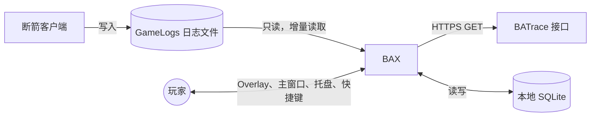
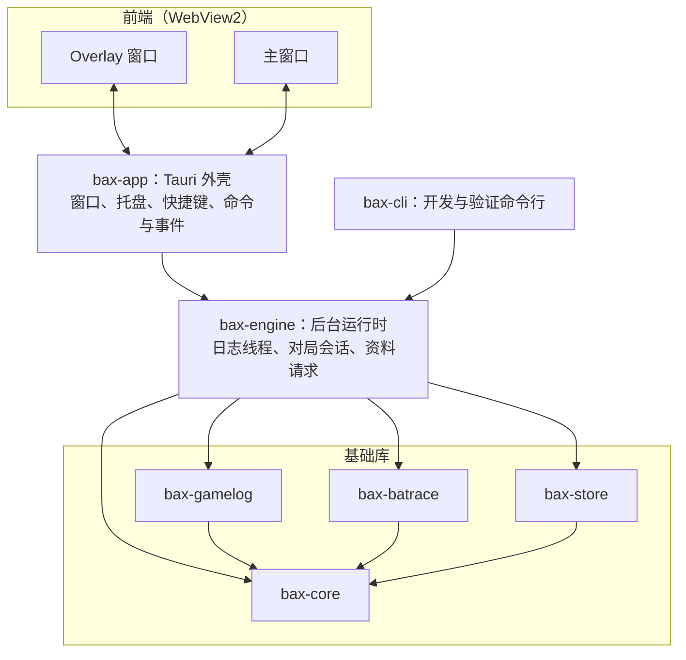
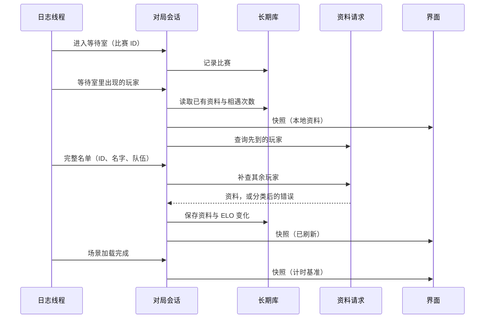
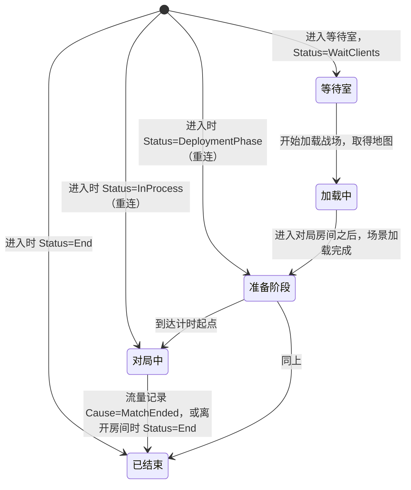

# BAX 总体架构

状态：草案 · 更新：2026-11-17 · 依据：[项目规划](../planning/project-plan.md)

本文说明 BAX 由哪些部分组成、各部分的职责边界、数据如何流动，以及代码仓库如何组织。需求、数据来源的实测结果和推进顺序以项目规划为准，这里只写结构。日志与接口的字段级细节见 [reference/](../reference/)。规划中标为待定的内容（前端框架等），本文给出边界和约束，具体取值留到对应的可行性验证之后。

## 设计约束

| 约束 | 来源 | 对结构的影响 |
|---|---|---|
| 游戏运行期间常驻 | Overlay 与计时提醒 | 后台任务保持轻量；较重的窗口和图表按需创建 |
| 数据只来自游戏日志文件和 BATrace | 规划的数据链路 | 只读文件与 HTTPS 请求，不读取游戏内存，不向游戏进程注入 |
| 外部来源不稳定 | 日志有重复事件、空名字、重连、AI 玩家；接口省略默认值，部分字段为空 | 解析与请求都要能表达“未知”和“缺失”，并且可以降级 |
| 备注与历史长期保留 | 玩家档案、相遇记录、战报归档 | 长期数据与可过期缓存分开存放 |
| 核心逻辑可回放测试 | 规划要求用真实日志回放覆盖重连、文件切换等情况 | 解析、状态机、统计不依赖窗口、网络和系统时钟 |
| 首阶段不做作弊与异常行为判定 | 已确定事项 | 原型的检测规则与扫描流程不移植，见 [ADR-0002](../adr/0002-exclude-cheat-detection.md) |

## 系统上下文



BAX 与游戏之间只有两个接触面：读取游戏写出的日志文件，以及把一个置顶窗口叠在游戏画面上。

## 分层与模块



| 模块 | 职责 | 不做的事 |
|---|---|---|
| `bax-core` | 领域类型（玩家、比赛、队伍、日志事件）；对局生命周期跟踪器；计时基准 | 不做任何 IO，不读系统时钟，当前时间由调用方传入 |
| `bax-gamelog` | 发现 Steam 库与日志目录；增量读取（半行、UTF-8 边界、截断、新文件切换）；把日志行解析为事件；区分补读与实时 | 不维护对局状态，不解释事件的业务含义 |
| `bax-batrace` | HTTP 客户端；响应模型与缺失字段处理；错误分类 | 不写数据库，不决定何时刷新、何时重试 |
| `bax-store` | SQLite 连接、迁移和读写；长期库与缓存库 | 不发起网络请求，不读时钟 |
| `bax-engine` | 日志线程；对局会话（唯一写入当前比赛状态的任务）；刷新策略与请求调度；状态快照；历史日志导入 | 不依赖 Tauri，不涉及窗口 |
| `bax-app` | Tauri 外壳；把引擎的快照转给窗口、把窗口的命令转给引擎；窗口、托盘、快捷键；必要的 Win32 补充 | 不实现解析、刷新和统计规则 |
| `bax-cli` | 无界面运行引擎；日志回放与导入；接口探测；用真实数据检查模型 | 不是面向使用者的程序 |
| 前端 | Overlay 与主窗口的展示、交互和主题 | 不保存业务状态的权威副本，不直接访问网络或文件 |

依赖方向是单向的：`bax-core` 不依赖其他成员；`bax-gamelog`、`bax-batrace`、`bax-store` 只依赖 `bax-core`，彼此之间不依赖；`bax-engine` 依赖这四个库；`bax-app` 和 `bax-cli` 依赖引擎。原型里 `Overlay` 一个类同时调度界面、查询和检测，这里用编译单元把这几件事隔开。拆分理由与备选方案见 [ADR-0003](../adr/0003-workspace-layout.md)。

## 仓库结构

```text
BAX/
├── Cargo.toml              Cargo workspace 清单
├── .cargo/config.toml      构建环境修正（见开发指南）
├── crates/
│   ├── bax-core/           领域模型、生命周期、计时
│   ├── bax-gamelog/        日志发现、读取、解析
│   ├── bax-batrace/        BATrace 客户端
│   ├── bax-store/          SQLite 存储
│   └── bax-engine/         后台运行时
├── tools/
│   └── bax-cli/            开发与验证命令行，可执行文件名 bax
├── src-tauri/              bax-app：Tauri 外壳（0.2 起）
├── src/                    前端源码（0.2 起，框架待定）
├── fixtures/               虚构的日志与接口样本，按原始字节保存
├── docs/                   文档，见 docs/README.md
└── .local/                 本机原始数据，不入库
```

`src-tauri/` 与 `src/` 放在仓库根目录，与 Tauri 命令行工具的默认约定一致，在开始做窗口时创建。

## 运行时结构

桌面应用是一个 Tauri 进程加上 WebView2 子进程；命令行工具只有引擎，没有窗口。引擎内部有这些执行单元：

| 执行单元 | 实现 | 输入 | 输出 |
|---|---|---|---|
| 日志线程 | 系统线程，每 0.5 秒读一次 | 日志目录的变化 | 日志事件、读取状态 |
| 对局会话 | 异步任务 | 日志事件、接口结果、界面命令、每秒一次的计时 | 写入长期库；发布快照 |
| 资料请求 | 异步任务，同时最多 5 个 | 会话给出的玩家 ID | 资料或分类后的错误 |
| 战后归档 | 0.4 加入 | 比赛结束 | 战报入库，相关玩家档案更新 |
| 提醒调度 | 0.2 加入 | 计时基准与提醒配置 | 提醒事件 |

对局会话是唯一写入当前对局状态的任务。所有输入以消息形式排队进入，按顺序处理，状态不需要跨任务加锁。每个请求带上发起时的比赛代次；结果返回时比赛已经切换的，资料照样存进长期库，但不再更新界面。这对应原型 `EloService` 里的过期请求隔离。

### 刷新策略

- 先显示本地已有的资料，并标明它是不是这场比赛开始之后取得的。
- 一名玩家的资料不是在这场比赛开始之后取得的，就重新取一次。等待室里先出现的玩家立即开始查，完整名单到了再补齐其余的人，已经取过的不重复请求。
- 启动时补读出来的历史比赛不发请求。补读结束时仍在进行的那一场照常刷新，用户在对局中途打开 BAX 也能看到资料。
- 暂时性失败（超时、网络、限流、站点出错）按 12 秒、24 秒各重试一次；站点要求限流时全部请求暂停，暂停时长取站点给出的值，没有给出时为 30 秒。“没有收录”和“被拒绝”不自动重试。
- 界面可以要求立即刷新当前比赛的全部玩家。

### 对局中的数据流



### 战后的数据流

比赛结束事件将触发战后归档（0.4）。战报在比赛结束后不一定立即可用，归档任务按退避间隔重试，并区分空结果、部分结果和最终结果；重试间隔和终止条件由[验证 3](../validation/README.md) 确定。战报入库后更新相关玩家的统计，主窗口再按需读取聚合结果。归档不依赖 Overlay 是否打开；应用在归档完成前退出的，下次启动时继续处理未完成的比赛。

## 对局生命周期

跟踪器把一场比赛的状态分成两个互不影响的维度：比赛进行到哪个阶段，以及本机与比赛服务器的连接。断线不改变阶段，比赛在断线期间照常进行。



连接状态：正常为“已连接”；离开房间且比赛没有结束时为“已断开”，原因（超时、主动退出等）随之报告；回到同一场比赛、尚未进入对局房间时为“重连中”。新比赛出现时，没有等到结束信号的上一场会被报告为“被取代”。

这张图按 913 份本机日志归纳，事件的原文格式、取值和样本统计见 [reference/gamelog.md](../reference/gamelog.md)。跟踪器遵守三条规则：

- 状态以比赛 ID 为键，同一事件重复出现时结果不变。游戏对同一件事会写新旧两种日志，重读日志时事件也会再来一遍。
- 跟踪器不区分实时与回放，回放历史日志得到的状态与当时实时得到的一致；要不要因此发请求或提醒，由引擎决定。
- 玩家以 ID 标识，名单中的名字可以为空。AI 玩家的 ID 为负数，每场重新编号，不进名单。

### 时间

`bax-core` 不读时钟，所有时间由调用方传入；引擎通过一个可替换的时钟取当前时间，测试里用手动拨动的时钟。日志里的时间是本机本地时间，按系统时区换算成 UTC 后使用，持久记录一律用 UTC 毫秒。

正常开局的计时基准是“场景加载完成 + 准备阶段长度”，准备阶段长度暂定 60 秒，与战报开始时间的对比见[验证 2 的记录](../validation/02-clock-calibration.md)。重连时日志给不出计时起点：同一次运行内的重连沿用跟踪器里的基准；游戏重启后的重连从长期库恢复上次记下的基准。基准有三种来源，可信程度依次升高：日志推算、手动校准、战报修正；可信的不会被不可信的覆盖。

## 前后端通信

业务状态只存在于 Rust 一侧，窗口和命令行都是它的订阅者（[ADR-0004](../adr/0004-state-ownership.md)）。

- **快照。** 每次状态变化，引擎发布一份完整的快照，带递增的修订号。快照只描述当前比赛，十几名玩家的摘要，体积很小，所以不再细分成增量事件。窗口加载时取最新的一份，之后订阅变化；订阅端只保留最新一份，处理得慢不会积压。计时显示由界面按快照里的开局时刻自己计算，引擎不每秒推送。
- **重数据按需读取。** 完整战报不放进快照。主窗口通过命令请求已经聚合好的结果，例如按时间分桶的出兵序列或单位排行；聚合在 Rust 里完成。
- **类型只定义一次。** 快照的类型以 Rust 定义为准，序列化为 camelCase 的 JSON；TypeScript 类型由它生成，生成工具随前端框架一并选定。

| 命令分组 | 内容 | 状态 |
|---|---|---|
| 会话 | 取得当前快照；刷新当前比赛的玩家资料 | 引擎已提供 |
| 设置 | 更换日志目录（记住选择，或改回自动定位） | 引擎已提供 |
| 计时 | 手动校准 | 0.2 |
| 提醒 | 新增、修改、取消 | 0.2 |
| 窗口 | 锁定与解锁 Overlay；展开与收起；打开主窗口 | 0.2 |
| 玩家 | 读取档案、历史相遇；读写备注 | 0.3 |
| 比赛 | 历史比赛列表；战后聚合数据 | 0.3、0.4 |

## 存储

| 类别 | 内容 | 生命周期 | 所在库 |
|---|---|---|---|
| 用户数据 | 设置；备注与提醒配置（之后加入） | 永久，只由用户修改 | 长期库 |
| 长期记录 | 玩家档案与 ELO 变化历史、比赛、名单（相遇记录由它得出）；原始战报（之后加入） | 永久；记录获取时间和来源 | 长期库 |
| 运行状态 | 每场比赛的计时基准；提醒触发状态与待归档比赛（之后加入） | 跨重启保留 | 长期库 |
| 参考数据 | 单位目录、专精目录（之后加入） | 随游戏版本刷新；归档战报靠它解读，所以与战报放在一起 | 长期库 |
| 接口缓存 | 短期的接口响应 | 可过期，可整体删除 | 缓存库 |

长期库和缓存库是两个独立的 SQLite 文件（[ADR-0005](../adr/0005-storage-separation.md)）。原型的 `Cache` 在初始化时删除 7 天前的记录，分成两个文件后，任何清理缓存的代码都接触不到长期数据。

- 文件位置：长期库是 `%LOCALAPPDATA%\BAX\bax.db`，缓存库是 `%LOCALAPPDATA%\BAX\cache\cache.db`。环境变量 `BAX_DATA_DIR` 可以换掉 `%LOCALAPPDATA%\BAX` 这一层。桌面应用和命令行工具用同一个位置。
- 玩家用游戏内部 ID 关联，Steam ID 是附加字段；比赛用 match ID 去重。写入都是幂等合并：同样的状态写多少遍结果都一样，不完整的状态不会抹掉已有信息。
- 接口资料只更新外部资料的列，不动日志里看到的名字和相遇时间。资料原文整份保留，以后口径变了可以重新解析。
- 资料缺失与数值为零分别保存，缺失用空值表示。
- 表结构变更通过带版本号的迁移脚本进行，脚本只增不改；长期库在迁移前先在旁边留一份备份；遇到更新版本创建的库时拒绝打开，不做任何修改。

第 1 版结构：`players`（档案与最近一次资料原文）、`player_ratings`（ELO、等级、排名、排位场次变化时追加一条）、`matches`、`match_players`（名单，保持日志里的顺序）、`settings`（键值，值为 JSON）。设置项目前有 `log.dir`（用户指定的日志目录）和 `self.playerId`（本机玩家）。

## 窗口

| | Overlay | 主窗口 |
|---|---|---|
| 生命周期 | 随应用常驻 | 按需创建；关闭后是否销毁由验证 5 的资源数据决定 |
| 内容 | 当前对局、玩家摘要、计时；展开后显示更多摘要 | 完整档案、历史、备注编辑、图表、设置 |
| 交互 | 锁定（整窗穿透）与解锁（可交互）两种模式 | 普通窗口 |
| 焦点 | 显示和提醒时不夺取游戏焦点 | 正常获取焦点 |

托盘和全局快捷键属于 `bax-app`。Tauri 自带能力不足以实现穿透或不抢焦点时，在 `bax-app` 内用 Win32 补充，范围由验证 1 确定。

## 原型代码的归属

| 原型位置 | BAX 中的归属 |
|---|---|
| `_steam_library_dirs`、`find_game_logs` | `bax-gamelog`，保留手动指定路径 |
| `LogWatcher` | 读取与行解析进入 `bax-gamelog`，对局状态进入 `bax-core` |
| `fetch_json` | `bax-batrace` |
| `EloService`、`_warm`、`_fill_levels` | 请求进入 `bax-batrace`，刷新策略与调度进入 `bax-engine` 的对局会话 |
| `Cache` | `bax-store`，拆成缓存库与长期库 |
| `TrayIcon` 与窗口相关方法 | `bax-app` |
| `elo_cheat_check.py` 中的比赛列表查询、单位目录映射 | 请求进入 `bax-batrace`，客观统计进入 `bax-core`；检测规则与扫描流程不移植 |

已经移植的代码登记在 [NOTICE.md](../../NOTICE.md)。

## 测试策略

| 对象 | 方式 |
|---|---|
| `bax-core` | 用事件序列驱动跟踪器，覆盖正常开局、重连、断线、新旧日志写法重复、比赛被取代、遭遇战干扰 |
| `bax-gamelog` | 解析虚构的日志文本；在临时目录里逐字节追加、截断、换文件、删除文件 |
| `bax-batrace` | 用 `fixtures/batrace` 的虚构响应和本地模拟服务器测试解析、缺失字段和错误分类；不在自动测试中访问真实站点 |
| `bax-store` | 在临时数据库上测试幂等合并、迁移、备份与拒绝打开新版本的库 |
| `bax-engine` | 端到端：临时目录里的日志文件、本地模拟的 BATrace、手动拨动的时钟 |
| 真实数据 | 不进自动测试。用命令行回放本机全部日志、用原型缓存里的真实响应检查模型，结果写进验证记录 |
| Overlay 与界面 | 实机验收，按验证 1 的清单执行 |

真实日志和接口响应包含其他玩家的 ID 与名称。测试和样本只用虚构的值，原始文件只放在不入库的 `.local/`。

## 待定事项

| 待定 | 由什么决定 |
|---|---|
| 是否最终采用 Tauri＋Rust | 验证 1、验证 5 |
| 前端框架、图表库、类型生成工具 | 验证 5 和原型开发体验 |
| 准备阶段的长度与手动校准方式 | 验证 2（进行中，日志与战报已对齐到 1 秒以内） |
| 战报重试策略 | 验证 3 |
| 单位归属与分类口径、逐场专精是否可得 | 验证 4 |
| 战报、备注、提醒的表结构 | 开发对应功能时确定 |
| BATrace 的请求频率与允许的接入方式 | 正式发布前与站点确认 |
